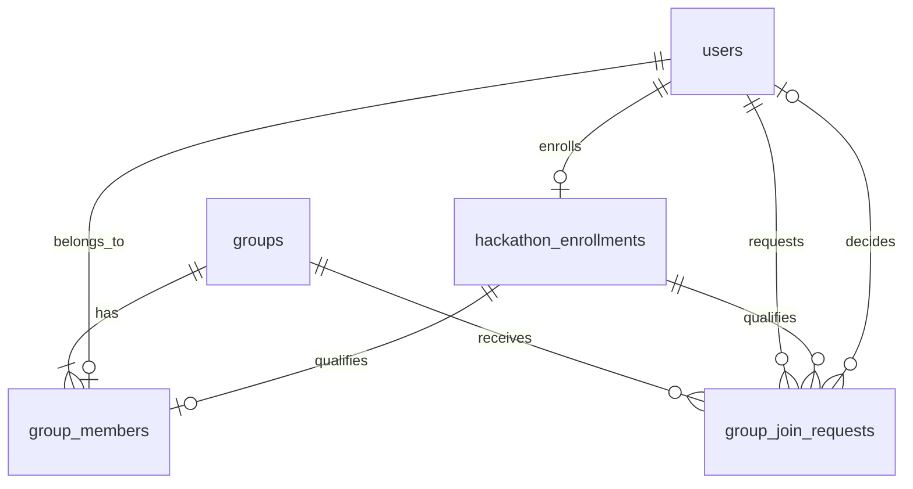

# Database Tables and Relationships (SCRUM-11)

**Status: planned schema.** This document describes the tables, fields, keys, and
relationships needed for registration, hackathon enrollment, group membership,
and group permission checks.

The application serves only the Tech Start Hackathon 2026 event. Each user can
have one enrollment record, identified by `user_id`. A separate `hackathons`
table and `hackathon_id` fields are not needed.

The names and role rules follow [Luis's auth plan](https://github.com/techstartucalgary/Tech-Start-Hackathon-2026/blob/681edbc1d17d3f4337d89af3cac1629a52f01a05/docs/auth/ai-architecture-prompt.md).
The ticket's **owner** is stored as **`lead`** in that plan. Joining uses a request
that must be approved before the user becomes a `member`.

## Tables and fields

The database is SQLite. PK means primary key; FK means foreign key. Fields are
required unless marked nullable. Timestamps use UTC `TEXT` and default to
`CURRENT_TIMESTAMP` unless stated otherwise.

### `users`

Stores the registered account and its global role (`user` or `organizer`).
Group roles are separate: a `lead` creates the group, a `member` has been
accepted, and a requester has a pending `group_join_requests` record until
accepted. These group relationships do not replace the account's global role.

| Field           | Type           | Key / purpose                                                        |
| --------------- | -------------- | -------------------------------------------------------------------- |
| `id`            | INTEGER        | PK.                                                                  |
| `email`         | TEXT           | Unique, case-insensitive email address.                              |
| `password_hash` | TEXT, nullable | Hashed password; nullable for Google-only accounts in the auth plan. |
| `display_name`  | TEXT           | User's display name.                                                 |
| `role`          | TEXT           | `user` or `organizer`; defaults to `user`.                           |
| `created_at`    | TEXT           | Registration time.                                                   |

Registering creates a user account. Enrollment and group membership are stored
separately; neither is implied by registration.

### `hackathon_enrollments`

Stores a registered user's enrollment in this hackathon.

| Field        | Type    | Key / purpose                                  |
| ------------ | ------- | ---------------------------------------------- |
| `user_id`    | INTEGER | PK; FK -> `users.id`. Must be supplied.        |
| `status`     | TEXT    | `active` or `withdrawn`; defaults to `active`. |
| `created_at` | TEXT    | Enrollment time.                               |

**PK:** `user_id`. This prevents duplicate enrollment records for the same user.
Withdrawal and re-enrollment update the existing row's `status`. The backend
requires an active enrollment before the user creates or joins a group.

### `groups`

Stores groups for this hackathon.

| Field        | Type    | Key / purpose        |
| ------------ | ------- | -------------------- |
| `id`         | INTEGER | PK.                  |
| `name`       | TEXT    | Group name.          |
| `created_at` | TEXT    | Group creation time. |

Ownership is stored in `group_members.role`, avoiding a second ownership field
that could disagree with the membership record.

### `group_members`

Stores accepted group membership and each user's role within the group.

| Field       | Type    | Key / purpose                                              |
| ----------- | ------- | ---------------------------------------------------------- |
| `group_id`  | INTEGER | Part of composite PK and group FK below.                   |
| `user_id`   | INTEGER | Part of composite PK and enrollment FK below; also unique. |
| `role`      | TEXT    | `lead` (owner) or `member`; defaults to `member`.          |
| `joined_at` | TEXT    | Time membership was created.                               |

- **PK:** `(group_id, user_id)`.
- **FK:** `group_id` -> `groups.id`.
- **FK:** `user_id` -> `hackathon_enrollments.user_id`, which links to `users`.
- **Unique:** `user_id`, matching Luis's rule that a user belongs to at most one
  group across the application.
- **Unique partial index:** `group_id WHERE role = 'lead'` prevents multiple
  owners in one group. The backend must also ensure every group has an owner;
  this index alone does not prevent a group with zero owners.

The foreign keys require an existing group and an enrolled user. The backend
separately checks that the enrollment is active.

### `group_join_requests`

Supports Luis's approval flow. A pending requester is not yet a group member.

| Field        | Type              | Key / purpose                                                                                                              |
| ------------ | ----------------- | -------------------------------------------------------------------------------------------------------------------------- |
| `id`         | INTEGER           | PK.                                                                                                                        |
| `group_id`   | INTEGER           | FK -> `groups.id`.                                                                                                         |
| `user_id`    | INTEGER           | Requesting user; FK -> `hackathon_enrollments.user_id`.                                                                    |
| `status`     | TEXT              | `pending`, `approved`, `declined`, or `cancelled`; defaults to `pending`.                                                  |
| `decided_by` | INTEGER, nullable | FK -> `users.id`; user who approved, declined, or cancelled the request. Null while pending or for automatic cancellation. |
| `created_at` | TEXT              | Request creation time.                                                                                                     |
| `decided_at` | TEXT, nullable    | Decision time; no default, null while pending.                                                                             |

- **FK:** `group_id` -> `groups.id`.
- **FK:** `user_id` -> `hackathon_enrollments.user_id`.
- **Unique partial index:** `(group_id, user_id) WHERE status = 'pending'`
  prevents duplicate pending requests by the same user to the same group.

An approved request results in a `group_members` row with role `member`.
Current membership is always read from `group_members`, not request history.

## Relationships

- A user has zero or one enrollment record for this hackathon.
- All groups belong to this single event.
- A group has one or more members, with exactly one owner (`lead`). Each user
  belongs to zero or one group under the current auth plan.
- Membership and join requests require enrollment.
- A group can receive many join requests. Each request belongs to one requesting
  user, with an optional reference to the user who decided it.

## Application flow

1. **Register:** create a `users` row with global role `user`.
2. **Enroll:** create an active `hackathon_enrollments` row keyed by `user_id`.
   If the user previously withdrew, reactivate their existing enrollment.
3. **Create a group:** confirm active enrollment and no existing membership.
   Create the `groups` row and the creator's `group_members` row with role `lead`
   in one transaction. The creator is now the owner.
4. **Join a group:** require active enrollment,
   no existing membership, and no pending request to that group before creating
   a pending `group_join_requests` row. Only the target group's lead or an
   organizer with `group:members:manage:any` may approve a pending request.
   Recheck active enrollment and absence of another membership at approval,
   then insert a `group_members` row with role `member` and mark the request
   approved in one transaction. If the requester is no longer eligible, cancel
   the stale pending request and return `409`, as specified in the auth plan.
   Cancel the user's other pending requests in the transaction that makes them
   a member or creates their group.
5. **Identify the group:** for a modification request, load the target group by
   its ID and look up membership using both that group ID and the authenticated
   user's ID.
6. **Check roles and permissions:** read `users.role` and, when present, the
   target group's `group_members.role`; resolve the required permission using
   the mapping below.
7. **Allow or reject:** permit the modification only if the user has the required
   permission. Otherwise reject it without modifying the group.

## Group roles and permission checks

Following Luis's plan, global roles live in `users.role`, group roles live in
`group_members.role`, and role-to-permission mappings live in backend code.
Separate permission tables are not needed for this design. A requester has no
membership role until accepted.

For a group modification, the required permission is `group:update`:

| User's role and relationship to the target group               | Permission                   | Result                                         |
| -------------------------------------------------------------- | ---------------------------- | ---------------------------------------------- |
| Owner (`lead`) of this group                                   | `group:update`               | Allow.                                         |
| Regular `member` of this group                                 | No `group:update` permission | Reject.                                        |
| Regular user outside this group, including a pending requester | No membership or override    | Reject.                                        |
| Global `organizer`, whether or not a member                    | `group:update:any`           | Allow through the explicit organizer override. |

The backend performs these checks on every group modification request:

1. Identify the authenticated user; reject with `401` if not signed in. The
   acting user ID comes from authentication, not a user ID supplied in the body.
2. Load the target group; reject with `404` if it does not exist.
3. Load `group_members` by `(group_id, user_id)`. Reject with `403` if there is
   no membership and no explicit organizer override for the requested action.
4. Check the required permission using the current global and group roles.
   Reject with `403` if the permission is missing.
5. Validate the input (`400` for invalid input), then check the applicable
   current-state rules (`409` if blocked). Only then allow the update. This
   preserves the auth plan's check order: `401` -> `404` -> `403` -> `400` -> `409`.

Membership in a different group never grants permission over the target group.
